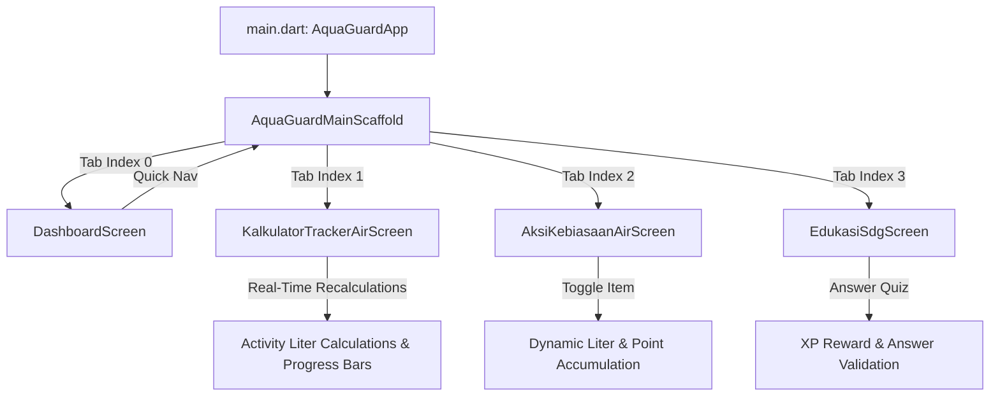

# 💧 AquaGuard Project Overview

**AquaGuard** is an interactive, mobile-first water conservation and sustainability application designed to monitor, educate, and empower individuals and communities to manage water consumption efficiently. Built using Flutter and Dart, the application directly champions **United Nations Sustainable Development Goal 6 (SDG 6: Clean Water and Sanitation)**, with an emphasis on **Target 6.4 (Water-use Efficiency & Scarcity)** and **Target 6.1 (Safe Drinking Water)**.

AquaGuard addresses the growing challenge of urban water overconsumption and low public awareness of daily water footprints. It accomplishes this through four core functional modules:

1. **🏠 Beranda (Dashboard):** Provides an immediate high-level summary of daily water intake/usage, active campus challenges, quick meter metrics, and contextual conservation tips.
2. **🚰 Kalkulator & Tracker Air (Tracker):** An interactive diagnostic calculator that computes daily water usage across domestic activities (shower, toilet flush, kitchen, laundry) against national urban benchmarks (180 L/capita/day), calculating cost estimates and potential savings.
3. **✅ Aksi & Kebiasaan Air (Action Checklist):** A gamified daily action center featuring category filters, habit checklists with real-time liter and Eco-Point counters, and collective campus missions.
4. **📚 Edukasi & Target SDG 6 (Education Hub):** Bite-sized micro-learning modules (2–3 minutes) breaking down United Nations SDG 6 targets, complemented by interactive quizzes, flashcards, and an XP progress reward system.

---

# 🌍 Context

## 📝 Background & Real-World Relevance

Water scarcity and inefficient municipal water usage are critical global challenges. In urban and campus environments, individual water consumption often exceeds sustainable limits due to a lack of visibility into activity-based consumption habits (e.g., protracted showers, running faucets during dishwashing, and non-eco toilet flushing).

## 🎯 Target Audience & Use Case

- **🎓 University Students & Campus Residents:** Students living in dormitories or campus housing participating in green campus initiatives ("Kampus Hijau Berkelanjutan").
- **🏡 Eco-Conscious Urban Households:** Individuals seeking transparent estimation of their domestic water utility costs and actionable reduction targets.
- **🌱 Academic & Sustainability Demonstrations:** An educational reference tool demonstrating how mobile interfaces can drive sustainable behavioral changes without requiring cumbersome hardware setups.

## 📱 Environment & Implementation Scenario

AquaGuard is designed as an accessible personal pocket guide. It bridges the gap between high-level sustainability targets (UN SDG 2030 Agenda) and practical, day-to-day habits. By breaking down consumption into clear metrics (liters, rupiah estimates, and community progress), users can immediately quantify the impact of their conservation efforts.

---

# ⚙️ Constraints

To maintain project scope, focus, and rapid client-side responsiveness, the development of AquaGuard adheres strictly to the following boundaries:

- **📱 Pure Mobile Target (Client-Side Only):** Designed specifically for mobile form factors (portrait layout, safe-area bounds, mobile touch ergonomics). While compatible with Flutter desktop and web runtimes for testing, all UI flows and modals are optimized for smartphone screens.
- **🔒 Zero Backend / Standalone Architecture:** The application does not integrate external REST APIs, GraphQL, Firebase, or cloud databases. All state is maintained locally in client memory using native Flutter `StatefulWidget` and `setState`.
- **🧪 Mocked Data Layer:** User profile metrics, weekly liter statistics, campus mission progress bars, and module statuses are initialized with deterministic, realistic mock data embedded within client models.
- **🎨 Strict Brand Integrity:** The official AquaGuard logo asset (`assets/images/aquaguard_logo.png`) must remain unmodified—preserving its original aspect ratio, color palette, and vector geometry without automated filters or substitution with generic icons.
- **🛠️ Platform & Runtime Dependencies:**
  - Requires **Flutter SDK 3.13.4+** and **Dart 3.x**.
  - Depends solely on vetted core dependencies (`cupertino_icons`, `material_color_utilities`) to avoid dependency bloat.
  - Building production Android binaries (`.apk`) requires a configured **Android SDK (API 34/35)** and **JDK 17+**.

---

# 🏗️ System Architecture & Technical Flow

## 📁 High-Level Folder Layout

```text
Mobile Front End (New)/
├── android/                   # Native Android configuration and Gradle build files
├── assets/
│   └── images/
│       ├── aquaguard_logo.png # Official AquaGuard branding asset
│       └── kampus_hijau.jpg   # Campus environmental card background
├── lib/
│   ├── main.dart              # Application entrypoint, theme, navigation scaffold, DashboardScreen
│   └── screens/
│       ├── tracker_screen.dart # Tab 1: Kalkulator & Tracker Air (activity steppers, budget formulas)
│       ├── aksi_screen.dart    # Tab 2: Aksi & Kebiasaan Air (checklist models, category filters)
│       └── edukasi_screen.dart # Tab 3: Edukasi & Target SDG 6 (modules, quizzes, XP tracker)
├── test/
│   └── widget_test.dart       # Widget smoke tests
└── pubspec.yaml               # Flutter package configuration and registered assets
```

### 🔄 Key Data Flows & Interactions



1. **🧭 Root Navigation (`AquaGuardMainScaffold`):**
   - Acts as the top-level state manager for tab switching (`_selectedNavIndex`).
   - Hosts a synchronized persistent bottom navigation bar featuring 4 tabs: _Beranda_, _Tracker_, _Aksi_, and _Edukasi_.

2. **🚰 Kalkulator & Tracker Module (`tracker_screen.dart`):**
   - Receives granular user adjustments via duration sliders and counter steppers (shower duration, toilet flush counts, kitchen wash sessions).
   - Dynamically evaluates formulas against the 180 L/capita/day standard, computing percentage distributions across activity categories in real time.

3. **✅ Aksi & Kebiasaan Module (`aksi_screen.dart`):**
   - Manages a list of `ActionItemModel` entities.
   - Enables categorical filtering (_Semua_, _Kamar Mandi_, _Dapur_, _Taman_, _Kebersihan_) and reactive toggling of completion status with instant visual feedback.

4. **📚 Edukasi & SDG Module (`edukasi_screen.dart`):**
   - Displays micro-modules mapped to SDG 6 targets.
   - Manages quiz interaction states (unanswered, correct answer, feedback dialog) and dynamically increments user XP scores.

---

# 🚀 Getting Started & Running the App

## 🧰 Prerequisites

- [Flutter SDK](https://docs.flutter.dev/get-started/install) (version 3.13.4 or later)
- [Dart SDK](https://dart.dev/get-dart) (included with Flutter)
- For Android build: [Android Studio](https://developer.android.com/studio) or Android SDK Command-line Tools with JDK 17+

## 1. 📥 Clone the Repository

```bash
git clone https://github.com/MitsuneX/Aqua-Guard.git
cd Aqua-Guard
```

## 2. 📦 Install Project Dependencies

Run `flutter pub get` to download and resolve required packages:

```bash
flutter pub get
```

## 3. 🔍 Verify Code Quality & Static Analysis

Ensure there are no compilation or linting issues:

```bash
flutter analyze
```

## 4. ▶️ Run Locally

To launch the app on an emulator, connected mobile device, or browser:

```bash
# Run on an automatically detected connected device or emulator
flutter run

# Or run in Google Chrome for immediate visual inspection
flutter run -d chrome
```

## 5. 📱 Compiling & Distributing the Mobile Release Binary (`APK`)

To generate a standalone Android release APK for manual distribution and physical device installation:

1. **🛠️ Verify Android SDK configuration:**

   ```bash
   flutter doctor
   ```

2. **🏗️ Compile the release APK:**

   ```bash
   flutter build apk --release
   ```

   Upon successful build, the APK will be generated at:

   ```text
   build/app/outputs/flutter-apk/app-release.apk
   ```

3. **📡 Share over Local Network (Wi-Fi):**

   To easily download the compiled APK to a physical mobile device on the same local Wi-Fi network, start a lightweight HTTP server:

   ```bash
   python -m http.server 8080 --directory build/app/outputs/flutter-apk/
   ```

   Then, on your mobile device's browser, navigate to:

   ```text
   http://<YOUR_COMPUTER_LOCAL_IP>:8080/app-release.apk
   ```
